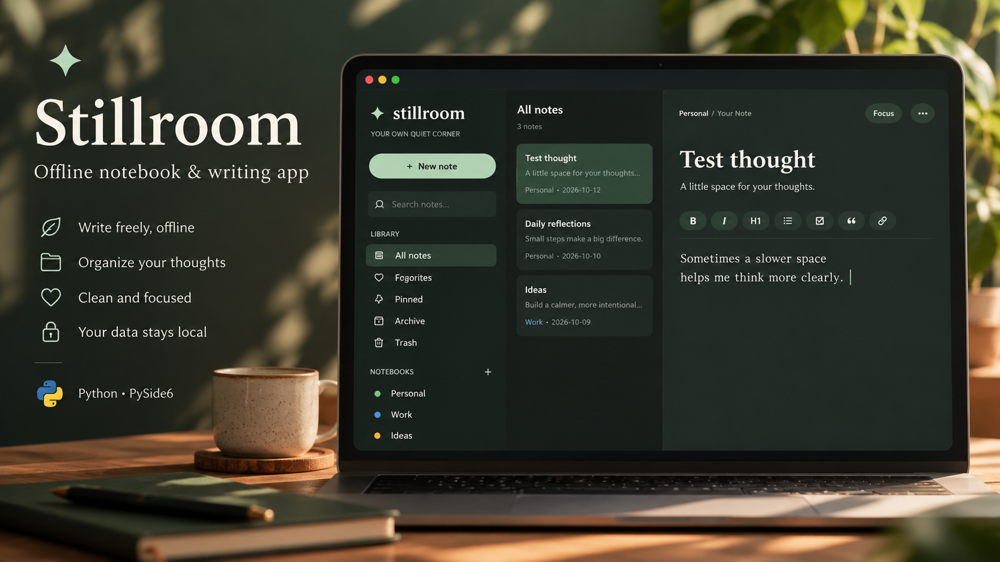

<div align="center">

# ✦ Stillroom

### Your own quiet corner.

**An offline, local-first notebook and rich-text writing app built with Python and PySide6.**



</div>

## About

Stillroom is a desktop notebook designed to make writing feel calm and uncomplicated. Capture quick ideas, write longer reflections, organise notes into notebooks, and return to them without accounts, subscriptions, or an internet connection. It combines a three-column notebook layout with a distraction-free writing canvas and direct rich-text formatting.

The project prioritises a focused experience, local data ownership, and a modest resource footprint over cloud services or unnecessary background activity.

## Features

- **Rich-text editor:** Format selected text with bold, italic, underline, headings, lists and indented quotes. Formatting is displayed directly in the editor rather than as Markdown characters.
- **Calm interface:** Rounded controls, comfortable spacing, a paper-inspired editor and light/dark themes.
- **Notebooks and tags:** Group notes into notebooks and add searchable tags.
- **Find what matters:** Search note titles, content, tags and notebooks.
- **Quick access:** Pin or favourite notes, and archive those you no longer need in your main view.
- **Recoverable deletion:** Move notes to Trash, restore them or permanently delete them.
- **Focus mode:** Hide surrounding navigation for a quieter writing space.
- **Autosave and backups:** Save notes locally, with a backup of previous data and an option to export a full JSON backup.
- **Export:** Export individual notes as HTML or plain text.
- **Offline:** No account, cloud sync, analytics or always-on service required.

> **Note:** The toolbar's task/checkbox action inserts a checkbox symbol; it does not create an interactive checkbox. Images, attachments, tables, synchronisation and encryption are not implemented in this release.

## Installation

### Windows — quick start

1. Install **Python 3.10 or later** from [python.org](https://www.python.org/downloads/). During installation, enable **Add Python to PATH**.
2. Download this repository using **Code → Download ZIP**, then extract it.
3. Double-click `START_STILLROOM.bat`.
4. On first launch, the script creates a local `.venv` and installs PySide6. Internet is required for that initial install; everyday use is offline.

### Windows, macOS or Linux — manual start

```bash
python -m venv .venv
```

Activate the environment:

```powershell
# Windows PowerShell
.venv\Scripts\Activate.ps1
```

```bash
# macOS / Linux
source .venv/bin/activate
```

Then run:

```bash
python -m pip install -r requirements.txt
python main.py
```

**Dependency:** `PySide6>=6.6,<7`. Stillroom does not use an embedded browser or run a local web server.

## Using Stillroom

Create a note with **New note** or `Ctrl+N`, choose a notebook, and start writing. Select text before applying formats using the toolbar or standard keyboard shortcuts. The note list and library panel let you navigate, filter, and manage your writing. Use the `•••` menu for note actions and export.

| Shortcut | Action |
| --- | --- |
| `Ctrl+N` | New note |
| `Ctrl+S` | Save |
| `Ctrl+F` | Search |
| `Ctrl+B` / `Ctrl+I` / `Ctrl+U` | Bold / italic / underline |
| `Ctrl+Shift+F` | Toggle focus mode |
| `Ctrl+Shift+E` | Export HTML |

## Where notes are stored

Stillroom stores your notes and settings locally, separately from the application files:

- **Windows:** `%APPDATA%\Stillroom\notes.json`
- **Linux:** `~/.local/share/Stillroom/notes.json`
- **macOS:** The current source uses `~/.local/share/Stillroom/notes.json` when `APPDATA` is unset.

Notes are stored as JSON. The `html` field preserves rich formatting while `body` is kept as a plain-text copy for search and compatibility. A pre-upgrade snapshot (`notes.pre-v3.json`) and previous-save backup (`notes.v3.backup.json`) help protect against migration and accidental overwrites. You can also export all notes through the app's Backup option.

**Before upgrading or reverting:** Export a JSON backup. Older Stillroom versions do not understand rich-text HTML and may discard it if they save the same notes.

## Project files

```text
Stillroom/
├── main.py                 # Application and local storage logic
├── requirements.txt        # PySide6 dependency
├── START_STILLROOM.bat     # Windows virtual-environment launcher
├── README.md               # Documentation
├── dv-project.json         # DVExperiments project metadata
└── assets/
    └── stillroom-cover.png # Promotional dashboard image
```

## Design principles

Stillroom began with a question: can a useful writing app feel polished without needing an account, a browser-based interface, or background services? The PySide6 rewrite brings proper rich-text editing and a more coherent desktop interface while keeping writing and storage on the user's computer.

Qt is more resource-intensive than a bare Tkinter window, but avoids the overhead of an embedded browser framework. Exact CPU and RAM usage has not been benchmarked.

## Current status

**Version:** 3.0.3 (PySide6 desktop edition)

This release includes Qt6 startup compatibility corrections and a sidebar layout fix for notebook labels being clipped at smaller window heights. The code has received syntax checks and focused storage tests; full graphical testing across operating systems and display scaling settings is ongoing. Windows is the primary target; other platforms have manual launch instructions but are not fully verified.

## Known limitations and future possibilities

Stillroom does not currently support real interactive task checkboxes, inline images, tables, cloud sync, end-to-end encryption or simultaneous multi-window editing. Possible future improvements include attachments, drag-and-drop note organisation, templates, keyboard-first navigation and more extensive accessibility testing.

## License

No open-source license has been selected yet. Add a `LICENSE` file before granting others permission to redistribute, modify or reuse this code. Publishing a repository publicly does not itself provide an open-source license.

---

<div align="center"><strong>Stillroom — space to think, space to write.</strong></div>
